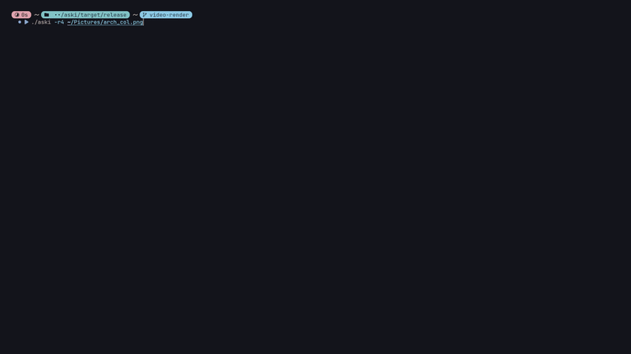

# aski

> True-color terminal renderer for images, GIFs, and videos.

[](https://www.rust-lang.org/) [](LICENSE) [](https://ffmpeg.org/)

aski turns regular media into ANSI block output using full-color escape codes, with aspect-ratio correction,
transparency support, streaming video decode, and cached playback inside the terminal, plus a reusable Rust rendering
library.

## Overview

- Render static **images** directly in the terminal
- Download direct **HTTP/HTTPS media URLs** with `--url` / `-u`
- Play animated **GIFs** natively
- Play **videos** through ffmpeg with buffered streaming decode
- Preserve aspect ratio using terminal cell geometry
- Blend transparency against a configurable background color
- Cache rendered ANSI frames for smoother repeat playback
- Rebuild automatically when the terminal is resized

## Quick Start

```sh
aski image.png
aski --url "https://example.com/photo.jpg"
aski -u "https://example.com/animation.gif" --loop
aski photo.jpg -b "#1e1e2e"
aski logo.png --opaque
aski animation.gif --loop
aski video.mp4 --precompute --loop
aski video.mp4 --prefetch 16 --fps-limit 30
aski clip.mp4 --no-cache --cell-width 9 --cell-height 20
```

## Examples

### Transparent static image


[Source](https://github.com/klpod221/klpod0s)

### Opaque static image


[Source](https://www.instagram.com/p/CLRnmbSFzq-/)

### Animated GIF


[Source](https://tenor.com/view/tung-tungtung-tungtungtung-sahur-tungtungtungsahur-tungtungsahur-gif-6699270143817937548)

### Video playback


[Source](https://blurbusters.com/hfr-120fps-video-game-recording/)

## Why aski

aski combines a few focused rendering techniques:

- 24-bit ANSI color output using `█`
- area-weighted downsampling instead of nearest-neighbor shortcuts
- correct handling of non-square terminal cells
- on-demand frame decode for animated media
- ANSI-string caching instead of retaining raw decoded frames in memory

## Feature Highlights

| Feature                    | What it does                                                                                          |
|----------------------------|-------------------------------------------------------------------------------------------------------|
| Aspect-ratio aware scaling | Fits media to the terminal using configurable cell dimensions (`--cell-width`, `--cell-height`)       |
| Real transparency          | Blends alpha against a configurable background instead of discarding it                               |
| Fast opaque path           | `--opaque` skips alpha math for images without meaningful transparency                                |
| Streaming video decode     | Uses ffmpeg in a background worker with bounded prefetch buffering                                    |
| ANSI frame cache           | Reuses rendered terminal frames on repeat playback instead of re-rendering every loop                 |
| Resize recovery            | Detects terminal size changes frame-by-frame and rebuilds output for the new size                     |
| Alternate-screen playback  | Keeps animation redraw isolated and restores the original terminal contents on exit                   |
| Runtime analytics          | `--verbose` reports dimensions, render timing, FPS, cache behavior, late frames, and playback summary |

## Playback Model

aski can play animated GIFs natively and most common video formats through ffmpeg.

| Mode           | Behavior                                                                                                               |
|----------------|------------------------------------------------------------------------------------------------------------------------|
| Default        | Decode, render, and display frames on demand. Cache ANSI frames when `--loop` is requested, unless `--no-cache` is set |
| `--precompute` | Render all frames before playback starts for smoother first-frame playback                                             |
| `--loop`       | Replay until interrupted with `Ctrl+C`                                                                                 |
| `--fps-limit`  | Slow playback below the source frame rate without skipping frames                                                      |
| `--prefetch`   | Buffer more decoded video frames ahead of display to absorb decode hiccups                                             |
| `--no-cache`   | Disable ANSI frame caching when memory matters more than repeated-loop efficiency                                      |

## Installation

### Pre-built binary

Download the latest executable from [GitHub Releases](https://github.com/voximir-p/aski/releases).

### From source

```sh
cargo install --path .
```

### Manual build

```sh
cargo build --release
./target/release/aski image.png
```

## Usage

```text
Usage: aski [OPTIONS] <MEDIA>
```

### Arguments

| Argument  | Description                                                                  |
|-----------|------------------------------------------------------------------------------|
| `<MEDIA>` | Path to an image, GIF, or video; with `--url`, a direct HTTP/HTTPS media URL |

### URL input

Use `-u` or `--url` to treat `<MEDIA>` as a URL:

```sh
aski --url "https://example.com/photo.jpg"
aski "https://example.com/animation.gif" -u --loop
aski -u "https://example.com/download?id=42&format=mp4" --precompute
```

Supply a direct media URL, rather than a web page such as a YouTube watch page,
a GIF sharing page, or a streaming playlist. Quote URLs to protect shell characters
such as `&`. HTTP and HTTPS are supported, including redirects (up to 10).
HTTPS certificates are verified.

A direct URL can still be protected by the hosting site. aski cannot complete
browser verification such as a Cloudflare challenge or use your browser's login
session. If a download reports browser verification or HTTP 403, open the URL in
your browser, complete any verification, and save the media. Then render the local
file without `--url`. Changing the user agent alone does not necessarily resolve these restrictions.

The complete file is downloaded to a temporary directory before rendering, using
bounded download buffers instead of loading the whole response into memory. Images
and GIFs are identified by their contents, so missing extensions, query strings, and
misleading filenames work. Other files go through the video decoder and require
`ffmpeg` and `ffprobe`, just like local videos.

Downloads show progress on stderr in a terminal or with `--verbose`. Ctrl+C cancels
downloading or playback. The temporary file is reused across loops and resizes,
including with `--no-cache`, and removed on normal exit, errors, or Ctrl+C.
A connection has 10 seconds to open; a stalled response times out after 30 seconds
without data. There is no total download duration limit. Without `--url`, `<MEDIA>`
continues to be treated as a local path.

### Display options

| Option                     | Description                                                            |
|----------------------------|------------------------------------------------------------------------|
| `-b, --background <COLOR>` | Background color for transparent areas. Default: `#1a1515`             |
| `-o, --opaque`             | Skip alpha blending math for faster rendering on opaque sources        |
| `-r, --reserve <ROWS>`     | Keep rows below the image; animation uses one for status. Default: `2` |

### Scaling options

| Option               | Description                                                    |
|----------------------|----------------------------------------------------------------|
| `--cell-width <PX>`  | Terminal cell width hint for aspect correction. Default: `10`  |
| `--cell-height <PX>` | Terminal cell height hint for aspect correction. Default: `22` |

### Playback options

| Option              | Description                                           |
|---------------------|-------------------------------------------------------|
| `-l, --loop`        | Loop playback until interrupted                       |
| `-p, --precompute`  | Render all frames before playback starts              |
| `--fps-limit <FPS>` | Cap playback FPS. `0` means use the source frame rate |

### Performance options

| Option                | Description                                                         |
|-----------------------|---------------------------------------------------------------------|
| `--prefetch <FRAMES>` | Queued video frames, `0`–`1024`. Default: `8`; `0` means unbuffered |
| `--no-cache`          | Disable ANSI frame caching                                          |

### Diagnostics

| Option          | Description                                      |
|-----------------|--------------------------------------------------|
| `-v, --verbose` | Print runtime diagnostics and playback analytics |

## Terminal UI

Use `aski -h` for a compact option list and examples, or `aski --help` for full explanations.
Help colors follow terminal detection and `NO_COLOR`; media output always uses true-color ANSI sequences.

During animation, the default status line shows the playback mode, displayed frame count, loop number,
and stop control. `--verbose` adds FPS and, in wider terminals, render time and cache/late-frame counts:

```text
PLAY  frame 42  |  loop 1  |  Ctrl+C stop
CACHE  42  |  29.9/30.0 FPS  |  0 late  |  Ctrl+C stop
```

`PLAY` means frames are decoded and rendered on demand. `CACHE` means previously rendered frames are reused.
The displayed count is cumulative across loops; `late` counts missed timing deadlines, not dropped frames.

Precomputation reports its progress without needing `--verbose`:

```text
PREPARING  120 frames  |  3.4 MiB  |  0.8s  |  Ctrl+C stop
```

Status lines shorten as the terminal narrows. Set `--reserve 0` to maximize image space; `--verbose`
reserves a status row when possible. In a one-row terminal, the image takes priority.
Resizing restarts decoding and rebuilds any cached frames for the new dimensions.
Press **Ctrl+C** to stop; the cursor, line wrapping, and original screen are restored before diagnostics appear.

## Background Color Formats

The `--background` option accepts the CSS-like formats below, case-insensitively. RGB percentages and
hue units (`deg`, `rad`, `grad`, `turn`) are supported. Optional alpha must be `1` or `100%` because
the background itself is opaque. Named colors, relative colors, and `none` are not supported.
Invalid input is rejected rather than silently replaced with the default.

| Format                | Example                         |
|-----------------------|---------------------------------|
| Hex 6-digit           | `#15161c`, `0xff00ff`, `ae6742` |
| Hex 3-digit shorthand | `#abc`                          |
| `rgb()`               | `rgb(21, 22, 28)`               |
| `hsl()`               | `hsl(235, 14%, 10%)`            |
| `hwb()`               | `hwb(235 8% 86%)`               |
| `lab()`               | `lab(8 1 -3)`                   |
| `lch()`               | `lch(8 3 290)`                  |
| `oklab()`             | `oklab(0.11 0.002 -0.015)`      |
| `oklch()`             | `oklch(0.11 0.015 270)`         |

## How It Works

Each terminal cell becomes one output pixel, drawn using the Unicode full block character `█` and a 24-bit ANSI
foreground color.

For each image or animation frame, aski downsamples the source into terminal cells using area-weighted averaging, which
produces
smoother results than simple nearest-neighbor sampling. Fractional pixel coverage is preserved along both axes,
and images smaller than the terminal are enlarged without leaving empty cells. Channels are averaged in sRGB space.
The renderer reuses sampling geometry and row buffers and emits a color escape only when the color changes.

For animated media, frames are decoded as a stream and rendered one by one. For looping or precomputed playback, cached
data is the
rendered ANSI output rather than the raw RGBA frame buffer, which keeps repeated playback efficient without holding full
decoded frame history in memory.

## Supported Formats

| Type            | Support                                                                                                              |
|-----------------|----------------------------------------------------------------------------------------------------------------------|
| Static images   | Anything supported by the [`image`](https://crates.io/crates/image) crate: PNG, JPEG, WEBP, BMP, TIFF, TGA, and more |
| Animated images | GIF                                                                                                                  |
| Video           | MP4, MKV, AVI, MOV, WebM, FLV, WMV, M4V, TS, OGV via [ffmpeg](https://ffmpeg.org/)                                   |

## Performance Tuning

- Use `--opaque` when transparency is irrelevant
- Increase `--prefetch` if video playback stalls during decode bursts
- Use `--fps-limit` to lower CPU usage per second when slower playback is acceptable
- Use `--no-cache` for very long or high-resolution videos if memory is the priority
- Adjust `--cell-width` and `--cell-height` if your terminal font looks stretched or squashed

## Notes

- Animated playback uses the terminal alternate screen buffer when stdout is a terminal
- Resize events invalidate stale frame cache entries and trigger a rebuild
- The playback status line adapts to terminal width; `--verbose` adds analytics and a summary after terminal restoration
- `--precompute` requires caching and conflicts with `--no-cache`
- `--fps-limit` extends frame durations; it slows the media rather than dropping frames to preserve its duration
- One-shot streaming playback does not retain a frame cache
- Invalid colors and zero cell dimensions are reported as argument errors
- Video playback requires both `ffmpeg` and `ffprobe`; video has no audio
- Variable-rate videos currently use their average frame rate; GIFs retain their individual frame delays
- Video is decoded in its encoded orientation; rotation metadata is not applied
- Broken output pipes exit quietly, and decode failures return a nonzero exit status

## Troubleshooting

| Symptom                                          | What to check                                                                                                                        |
|--------------------------------------------------|--------------------------------------------------------------------------------------------------------------------------------------|
| `Failed to start ffprobe` or `ffmpeg`            | Install ffmpeg and make both executables available on `PATH`. Static images and GIFs do not need them.                               |
| Escape codes appear as text or colors look wrong | Use a terminal that supports ANSI escape sequences and 24-bit color. Output redirected to a file still contains ANSI codes.          |
| Image looks stretched                            | Adjust the cell dimensions to match your font. Lower `--cell-width` for horizontally squashed output; raise it for stretched output. |
| High memory use when looping                     | Use `--no-cache` and reduce `--prefetch`. Precomputing stores every rendered frame.                                                  |
| Status line has fewer details                    | Widen the terminal. Compact layouts prioritize frame count, FPS, and the stop hint.                                                  |
| Video plays more slowly with `--fps-limit`       | This option extends frame durations. Use `0` to follow source timing.                                                                |

## Rust Library

The package also exposes a library without terminal side effects or signal handlers:

```rust
use aski::{Renderer, compute_output_dims, parse_color};

fn main() -> Result<(), Box<dyn std::error::Error>> {
    let image = image::open("image.png")?.to_rgba8();
    let (width, height) = image.dimensions();
    let (columns, rows) = compute_output_dims(width, height, 80, 22, 10, 22);
    let mut renderer = Renderer::new(
        width, height, columns, rows, parse_color("#15161c")?, false,
    )?;
    println!("{}", renderer.render(image.as_raw())?);
    Ok(())
}
```

Reuse a `Renderer` for successive frames with the same dimensions. `render` borrows its output buffer;
call `.to_owned()` only when retaining a frame. Output uses CRLF between rows, ends in an ANSI reset,
and has no trailing newline. Invalid geometry and incorrectly sized RGBA buffers return `RenderError`.

`open_stream(path, &MediaType::Gif, 8)` lazily decodes animation frames. Videos use `MediaType::Video`;
dropping their stream closes the queue, kills and reaps ffmpeg, and joins the decoder worker.
`frames::open_stream_with_cancel` accepts an `Arc<AtomicBool>` for cancelling waits for video frames.
Stream errors implement `std::error::Error` and include decoding context.

## Development

```sh
cargo fmt --all -- --check
cargo clippy --locked --all-targets -- -D warnings
cargo test --locked
# Requires ffmpeg and ffprobe:
cargo test --locked --test cli --test url -- --include-ignored
cargo bench --bench render
# Unix terminal resize, Ctrl+C, and restoration checks (requires ffmpeg):
cargo build --locked
python3 tests/terminal_smoke.py target/debug/aski
```

Tests cover sampling against an independent two-dimensional reference, transparency, upscaling,
color parsing, variable frame timing, CLI failures, GIF playback, video decoder cleanup,
and URL downloads against a local HTTP server (redirects, content detection, errors, and cancellation).
The benchmark measures reused rendering buffers at 360p, 1080p, and 4K; it excludes decoding and terminal I/O.

## Changelog

Release history is tracked in [CHANGELOG.md](CHANGELOG.md).

## License

aski is licensed under the [GNU General Public License v3.0](https://www.gnu.org/licenses/gpl-3.0.html#license-text).
See [LICENSE](LICENSE).
